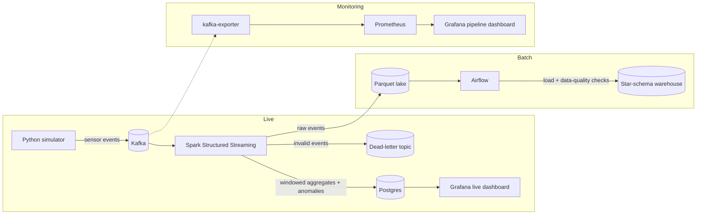

# FactorySentinel

Real-time IoT sensor pipeline: Kafka + Spark Structured Streaming + Airflow warehouse +
Prometheus/Grafana monitoring, all started with one `docker compose up`.

## Architecture



More detail in [docs/architecture.md](docs/architecture.md).

## Tech stack

| Area | Tool |
|---|---|
| Event transport | Apache Kafka (KRaft, single node) |
| Stream processing | Apache Spark Structured Streaming (PySpark) |
| Storage | PostgreSQL, Parquet |
| Orchestration | Apache Airflow |
| Monitoring | Prometheus, kafka-exporter, Grafana |
| Runtime | Docker Compose |
| Quality | ruff, pytest, pre-commit, GitHub Actions |

## Quick start

**Prerequisites:** Docker Desktop with at least 8 GB of RAM assigned, `make`, and Python 3.11
for local tooling.

```bash
cp .env.example .env
make up
```

| Service | URL |
|---|---|
| Spark master UI | http://localhost:8080 |
| Airflow | http://localhost:8081 (user `admin`, password from `.env`) |
| Grafana | http://localhost:3000 (user `admin`, password from `.env`) |
| Prometheus | http://localhost:9090 |
| Kafka (from the host) | `localhost:29092` |

Other commands: `make down`, `make logs`, `make ps`, `make test`, `make lint`.

## Project structure

```
simulator/    Sensor event generator
streaming/    Spark Structured Streaming jobs
warehouse/    Star-schema DDL and SQL
airflow/      Airflow DAGs
monitoring/   Prometheus config, Grafana provisioning and dashboards
tests/        Unit and integration tests
docs/         Architecture notes and screenshots
scripts/      Helper scripts
```

## Usage

To be added.

## Team

- Mathew
- Omar Khaled
- Ahmed
- Kerollos Gerges

## License

[MIT](LICENSE)
