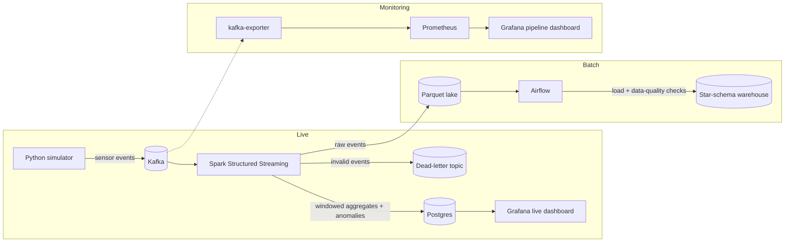

# Architecture

FactorySentinel has three paths: a **live** path that processes sensor events as they arrive, a
**batch** path that builds a warehouse for historical analysis, and a **monitoring** path that
watches the pipeline itself.

## Live path

The Python simulator generates machine sensor events and publishes them to Kafka. A Spark
Structured Streaming job consumes them, validates each event against the expected schema and
ranges, and routes invalid events to a dead-letter topic. Valid events are aggregated over time
windows and checked for anomalies; the results are written to Postgres, where a Grafana
dashboard shows them live.

## Batch path

The streaming job also writes every raw event to a Parquet lake. Airflow DAGs load that data
into a star-schema warehouse in Postgres and run data-quality checks on each load, so historical
questions can be answered without touching the live tables.

## Monitoring path

Prometheus scrapes metrics about the pipeline itself, starting with Kafka through
`kafka-exporter` (topic offsets, consumer lag). Grafana reads Prometheus to show whether the
pipeline is healthy, separate from the business dashboards.
